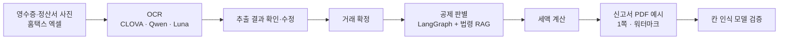
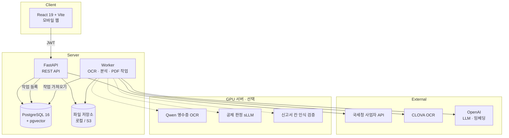

<div align="center">

# VAT-AI

**소상공인을 위한 부가가치세 신고 지원 서비스**

영수증 사진 한 장에서 부가세 신고서 예시까지 — 인식, 공제 판별, 세액 계산을 한 흐름으로 연결합니다.


</div>

> [!IMPORTANT]
> VAT-AI는 **프로토타입**입니다. 세무대리·세무 상담 서비스가 아니며 홈택스에 대신 신고하지 않습니다.
> - 매입세액 **공제 판정은 AI가 예측한 참고 정보**이고, 실제 세법 판단과 다를 수 있습니다.
> - 생성되는 **신고서 PDF는 작성 예시**입니다. 1쪽만 채워지고 가운데에 VAT-AI 워터마크가 들어가며, 실제 신고서로 제출하면 안 됩니다.

## 목차

- [프로젝트 소개](#프로젝트-소개)
- [주요 기능](#주요-기능)
- [서비스 흐름](#서비스-흐름)
- [시스템 아키텍처](#시스템-아키텍처)
- [기술 스택](#기술-스택)
- [AI 구성](#ai-구성)
- [폴더 구조](#폴더-구조)
- [시작하기](#시작하기)
- [환경 변수](#환경-변수)
- [테스트](#테스트)
- [관련 문서](#관련-문서)

## 프로젝트 소개

일반과세자 소상공인은 6개월마다 부가가치세를 신고해야 하지만, 영수증을 모으고 어떤 매입이 공제되는지 판단하는 일은 여전히 손으로 합니다.
VAT-AI는 이 과정을 다음처럼 줄입니다.

| 문제 | VAT-AI의 해결 |
|---|---|
| 종이 영수증을 하나하나 옮겨 적어야 한다 | 사진을 찍으면 OCR과 AI가 상호·날짜·금액·품목을 추출 |
| 어떤 매입이 공제되는지 알기 어렵다 | 부가가치세법 조문을 검색(RAG)해 **가능 / 불가능 / 애매** 로 판정하고 근거 조문을 함께 제시 |
| 매출 자료가 여러 곳에 흩어져 있다 | 배달앱·카드 정산서 사진과 홈택스 엑셀을 모아 신고기간별로 대조·확정 |
| 신고서 칸에 무엇을 적어야 할지 모른다 | 확정된 거래로 세액을 계산해 신고서(별지 제21호서식) 1쪽 예시 PDF를 생성 |

## 주요 기능

**회원가입 · 사업자 확인**
- 1단계 약관 동의: 이용약관, 개인정보 수집·이용, 국외 이전, **AI 판정 한계 안내**, **신고서 PDF 예시 안내** 등 필수·선택 항목을 나눠 받고 동의 기록을 문안 판과 함께 저장
- 국세청 사업자등록정보 진위확인·상태조회로 대표자·상호·사업자번호·개업일 검증
- 과세유형·업종·직전 과세기간 매출 등 신고에 필요한 사업자 정보 입력

**매입 영수증**
- 촬영 또는 앨범 업로드, 영수증 특징(짧고 선명 / 품목이 많음 / 글씨가 작거나 옅음)에 따라 인식 경로 선택
- 추출 결과 확인·수정, 사용 목적 질문으로 사업 관련성 확인
- 거래처를 기억해 다음 거래의 판정에 활용

**공제 판별**
- LangGraph 그래프가 거래를 쟁점별로 나누고 법령 조문을 검색해 판정과 사유를 작성
- "애매"는 시스템 오류가 아니라 **사업자만 아는 사실**에 따라 결론이 달라지는 경우로만 사용

**매출 · 신고**
- 정산서 사진·홈택스 엑셀 인식, 중복 확인, 신고기간별 매출 집계 확정
- 거래 확정·수정·휴지통, 예상 납부(환급)세액 요약
- 신고서 PDF 예시 생성 → 칸 인식 모델로 찍힌 값을 다시 읽어 검증 → 워터마크를 넣어 제공

## 서비스 흐름



## 시스템 아키텍처



- 무거운 처리(OCR, 공제 분석, PDF)는 API가 작업만 DB에 넣고, **별도 작업자 프로세스**가 가져가 처리합니다. 화면은 작업 상태를 조회합니다.
- 외부 호출은 교체 가능한 어댑터 계약 뒤에 있습니다. OCR은 `app/receipts/ocr/contract.py`(`OCR_PIPELINE`), 공제 판별은 `app/deduction/analyzer.py`(`DEDUCTION_ANALYZER`)입니다.
- GPU 서버(점선)는 선택 사항입니다. 꺼져 있으면 각 기능이 OpenAI 경로로 대체되거나 검증을 건너뜁니다.

## 기술 스택

| 구분 | 사용 기술 |
|---|---|
| Backend | Python 3.11+, FastAPI, SQLModel(SQLAlchemy 2), Alembic, Pydantic 2, Uvicorn |
| AI | LangGraph, OpenAI(LLM · `text-embedding-3-small`), CLOVA OCR, Qwen3 / Qwen3-VL LoRA |
| Database | PostgreSQL 16 + pgvector (`pgvector/pgvector:pg16` Docker 이미지) |
| 인증 | JWT(`python-jose`), `bcrypt` |
| PDF | reportlab, pypdf, pypdfium2 |
| Frontend | React 19, Vite, TypeScript, react-router-dom, axios |
| 테스트 | pytest, Node test runner |

패키지 버전은 `requirements.txt`, `requirements-dev.txt`, `frontend/package.json`이 기준입니다.

## AI 구성

### 영수증 인식 경로

| 사용자가 고른 특징 | 경로 | 처리 |
|---|---|---|
| 짧고 선명해요 | `qwen_ocr` | CLOVA OCR 글자·좌표 → Qwen3-4B LoRA가 거래 정보 구조화 |
| 품목이 많고 글씨는 선명해요 | `qwen_photo_ocr` | CLOVA OCR + 사진 → Qwen3-VL-8B LoRA |
| 글씨가 작거나 옅어요 | `luna_photo_ocr` | CLOVA OCR + 사진 → OpenAI 멀티모달 모델(Luna) |

Qwen 경로가 실패하면(GPU 서버 미연결 등) 이미 읽은 CLOVA 결과를 재사용해 **Luna 경로로 자동 대체**합니다.

### 공제 판별

1. 거래와 사업자 정보로 쟁점을 정하고, pgvector에서 관련 부가가치세법 조문을 검색합니다.
2. `DEDUCTION_SLM_URL`이 설정되어 있으면 소형 모델(Qwen3-4B LoRA)이 1차 판정을 하고, 아니면 LLM이 판정합니다.
3. 결과(가능 / 불가능 / 애매, 근거 조문, 사유)는 `Transaction`에 저장됩니다.

### 신고서 검증

신고서 금액은 모델이 만들지 않고 세액 계산 코드(`app/vat_return/engine.py`)가 정합니다. 칸 인식 모델(Qwen3-VL-4B LoRA, `training/serve.py`)은 PDF에 찍힌 값을 다시 읽어 계산값과 같은지만 확인합니다. 검증은 워터마크를 넣기 전에 하며, `FORM_VERIFIER_URL`이 비어 있거나 서버에 연결되지 않으면 건너뜁니다.

## 폴더 구조

```
VAT-AI/
├── app/                      FastAPI 백엔드
│   ├── main.py               앱 진입점, 라우터·CORS 등록
│   ├── core/                 설정(.env), DB 엔진·세션, JWT·비밀번호 해싱
│   ├── common/               공통 예외 처리
│   ├── auth/                 회원가입(약관 동의 기록)·로그인·비밀번호 재설정
│   ├── business/             사업자 정보, 국세청 진위 확인, 거래처 기억
│   ├── receipts/             영수증 저장·목록·조회, 상세·확인 질문
│   │   └── ocr/              OCR 파이프라인(계약, CLOVA, Qwen, Luna, 구조 파싱)
│   ├── sales_monthly/        매출 자료(정산서 사진·홈택스 엑셀) 인식·검토·보관
│   ├── sales_filing/         신고기간별 매출 집계·대조·확정
│   ├── transactions/         거래 확정·수정·휴지통·세액 요약
│   ├── deduction/            공제 판별 — analyzer(계약), graph(LangGraph), rag(법령 검색)
│   ├── vat_return/           세액 계산, 신고서 PDF 채우기·워터마크·검증
│   │   └── assets/           신고서 빈 양식, 워터마크 로고
│   ├── jobs/                 비동기 작업 API와 작업자(worker.py)
│   ├── team_benchmark/       팀원 권한, 인식 벤치마크 사례 조회
│   └── migrations/           Alembic 마이그레이션
├── frontend/                 React 앱 (src/api, components, pages, hooks, styles)
├── tests/                    백엔드 테스트(pytest)
├── training/                 모델 학습·서빙 코드 (신고서 칸 인식, 공제 sLLM, 영수증 OCR)
├── data/laws.json            RAG용 법령 조문 원본
├── docker/                   Postgres 초기화(pgvector 확장)
├── docs/                     기능별 설정 가이드
└── storage/                  로컬 업로드 파일 (git 제외)
```

## 시작하기

### 사전 준비

- Python 3.11 이상, Node.js, Docker
- 외부 API 키: OpenAI, CLOVA OCR, 공공데이터포털 국세청 사업자 API (`.env`에 입력)

### 1. 데이터베이스

```bash
docker compose up -d db
```

### 2. 백엔드

```bash
python -m venv .venv
.venv\Scripts\Activate.ps1          # Git Bash: source .venv/Scripts/activate
python -m pip install -r requirements-dev.txt
copy .env.example .env              # 값 채우기
python -m alembic upgrade head
python -m uvicorn app.main:app --reload --port 8000
```

API 문서: http://localhost:8000/docs

### 3. 작업자 (OCR · 분석 · PDF)

API 서버와 별도 터미널에서 같은 `.env`로 실행합니다. 코드를 바꾸면 작업자는 자동으로 다시 시작되지 않으므로 직접 재시작합니다.

```bash
python -m app.jobs.worker
```

### 4. 프론트엔드

```bash
cd frontend
copy .env.example .env              # VITE_API_URL=http://localhost:8000
npm install
npm run dev
```

웹: http://localhost:5173 (모바일 화면 기준 393×852)

### 5. 법령 데이터(RAG) 등록 — 최초 1회

```bash
python -m app.deduction.rag.load_laws      # data/laws.json → law_embeddings
python -m app.deduction.rag.fetch_laws     # 법령 개정 시 data/laws.json 갱신
```

### 6. GPU 모델 서버 (선택)

Qwen 영수증 OCR, 공제 sLLM, 신고서 검증 서버는 `training/` 아래 각 README를 따라 GPU 서버에서 띄우고, 주소를 `.env`의 `QWEN_OCR_BASE_URL`, `QWEN_PHOTO_OCR_BASE_URL`, `DEDUCTION_SLM_URL`, `FORM_VERIFIER_URL`에 넣습니다. 띄우지 않아도 앱은 동작합니다.

## 환경 변수

전체 목록은 `.env.example`에 있습니다. 핵심 항목은 다음과 같습니다.

| 키 | 설명 |
|---|---|
| `DB_URL`, `JWT_SECRET` | DB 연결, JWT 서명 키 |
| `OPENAI_API_KEY` | 공제 판별·임베딩·Luna 인식 |
| `DEDUCTION_ANALYZER` | 공제 판별 어댑터. 예: `app.deduction.graph.adapter:create_analyzer` |
| `OCR_PIPELINE` | 기본 OCR 어댑터. 예: `app.receipts.ocr.luna:create_pipeline` |
| `CLOVA_OCR_API_URL`, `CLOVA_OCR_SECRET_KEY` | CLOVA OCR (`CLOVA_API_KEY`는 예전 설정 호환용) |
| `NTS_BUSINESS_API_KEY` | 국세청 사업자 진위확인·상태조회 |
| `QWEN_OCR_BASE_URL`, `QWEN_PHOTO_OCR_BASE_URL` | Qwen 영수증 OCR 서버. 비우거나 꺼져 있으면 Luna로 대체 |
| `DEDUCTION_SLM_URL` | 공제 1차 판정 sLLM 서버. 비우면 LLM이 모두 판정 |
| `FORM_VERIFIER_URL` | 신고서 칸 인식 검증 서버. 비우면 검증 생략 |
| `VAT_FORM_FONT` | 신고서에 쓸 한글 TTF 경로. 비우면 맑은 고딕·나눔고딕 자동 |
| `SMTP_*`, `FRONTEND_URL` | 비밀번호 재설정 메일 |

## 테스트

```bash
python -m pytest                                  # 백엔드
cd frontend && node --test tests/*.test.mjs       # 프론트엔드 상태·이동 로직
```

## 관련 문서

| 문서 | 내용 |
|---|---|
| [docs/PASSWORD_RESET.md](docs/PASSWORD_RESET.md) | 비밀번호 찾기 이메일 인증 흐름과 SMTP 설정 |
| [training/README.md](training/README.md) | 신고서 칸 인식 모델(Qwen3-VL-4B LoRA) 학습·검증 서버 |
| [training/deduction/README.md](training/deduction/README.md) | 공제 판정 sLLM(Qwen3-4B LoRA) 데이터·학습 |
| [training/receipt_ocr/README.md](training/receipt_ocr/README.md) | 매입 영수증 Qwen OCR 서버 |
| [CLAUDE.md](CLAUDE.md) | 작업 규칙, 엔티티 관계, 구현 참고 사항 |
